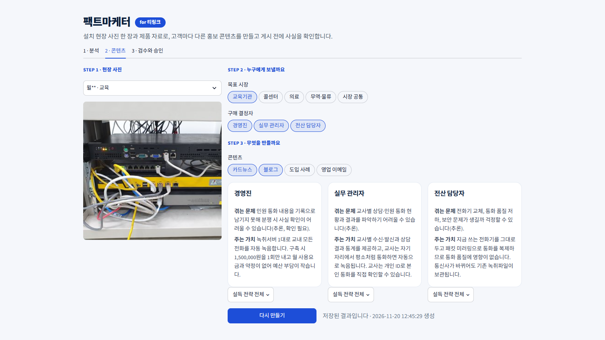
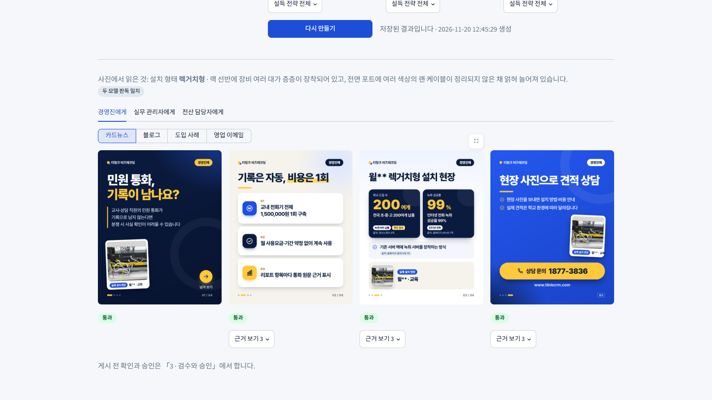
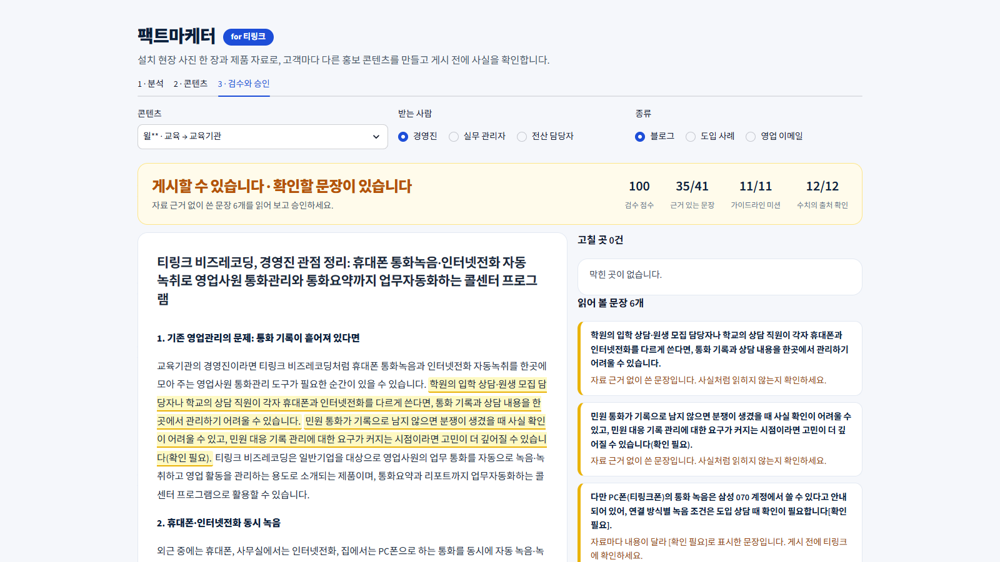
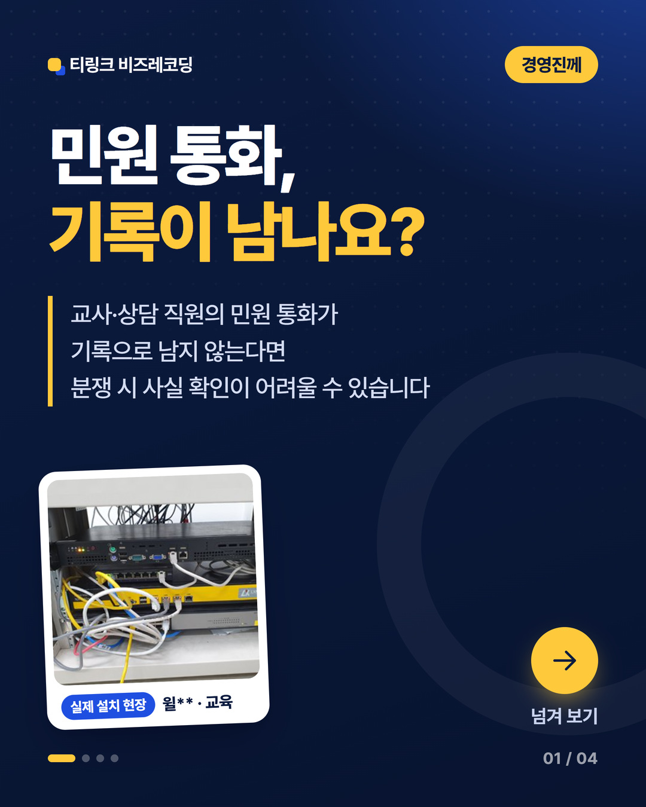
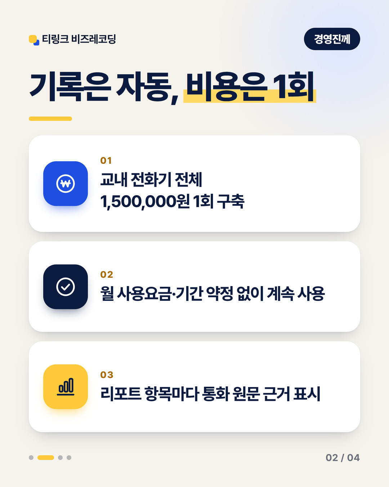
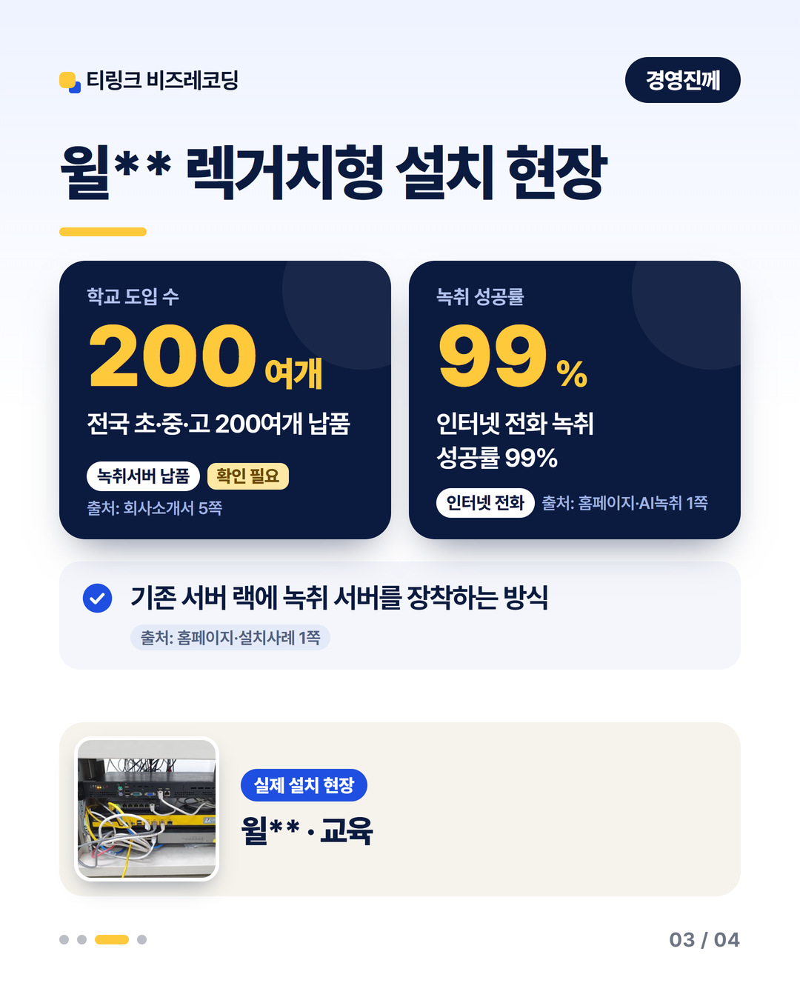
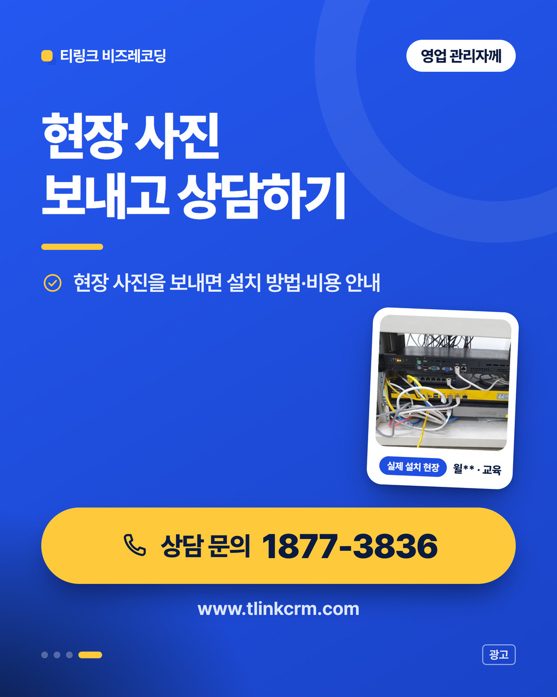

# 팩트마케터 for 티링크

티링크 전용 마케팅 솔루션입니다. 티링크의 제품 자료와 설치 현장 사진 한 장을 넣으면, AI가 제품과 기술적 차별점을 분석해 시장과 구매 결정자에 맞는 홍보 콘텐츠(카드뉴스 · 블로그 · 도입 사례 · 영업 이메일)를 만듭니다. 게시 전에 숫자 · 조건 · 고객명 · 금지 표현을 프로그램이 자료와 대조하고, 근거가 없는 문장은 사람이 읽도록 표시합니다.

제5회 AI 스마트워크톤(2026-11-20) 트랙 A 출품작. 과제: "티링크의 제품과 기술적 차별점을 AI가 분석하고, 현장 사진과 제품 정보만으로 고객의 관심을 끌 수 있는 홍보 콘텐츠를 자동 생성하는 마케팅 솔루션"

- 소개 사이트: https://factmarketer-web.vercel.app/ (직접 사용해 보기: https://factmarketer-web.vercel.app/app.html)
- 시연 영상: 2단계 제출란의 유튜브 주소 (2분 48초, 실제 화면 시연. 생성 장면은 저장된 답을 쓰지 않고 새로 만든 것이며 기다리는 구간만 빠르게 돌렸습니다)

| 사진 · 시장 · 결정자 · 종류 선택 | 결정자별 카드뉴스 | 검수와 승인 |
|---|---|---|
|  |  |  |

| 1장 문제 | 2장 해결 | 3장 근거 | 4장 제안 |
|---|---|---|---|
|  |  |  |  |

위 카드는 검수용 화면에 나오는 그대로입니다(1~3장은 경영진용, 4장은 실무 관리자용 예시). 3장의 "확인 필요" 배지와 "출처" 표시는 담당자가 보는 표시이고, 고객에게 보내기 전에 정리해야 합니다(아래 한계 참고).

무슨 사이트인지, 어떤 기능이 있는지, 어떻게 만들었는지는 [docs/프로젝트_소개.md](docs/프로젝트_소개.md)에 따로 적었습니다.

## 원칙
AI가 쓰고, 프로그램이 숫자와 조건을 확인하고, 사람이 승인합니다. 자료와 사진 속 문장은 지시가 아니라 데이터로만 다룹니다.

## 무엇을 하나

### 핵심 (1단계 기획서의 범위)
1. **분석** — 자료를 사실 카드(출처 파일 · 쪽, 원문 구절)로 정리하고 자료 간 불일치를 찾습니다. 제품의 기술적 차별점, STP · ICP · JTBD · USP, 구매 결정자 3역할을 냅니다. 항목마다 [확인된 사실] / [AI 추론] / [검증 필요]를 프로그램이 붙입니다.
2. **콘텐츠** — 같은 현장 사진 1장으로 경영진 · 실무(영업) 관리자 · 전산 담당자용 카드뉴스 4장과 네이버 블로그 원고를 만듭니다.
3. **검수와 승인** — 숫자, 조건(한정어), 고객명, 필수 키워드 3개, 티링크 블로그 가이드라인 미션 11개, 광고 표기를 프로그램이 검사합니다. 막힌 곳이 있으면 승인할 수 없고, 승인 뒤에 원고를 고치면 승인이 풀립니다. 승인한 것만 내려받습니다. 쓰지 않을 표현을 등록하면 검수와 다음 생성에 적용됩니다.

### 추가 (기획서에 없던 것)
- **시장 4종**: 콜센터 · 교육기관 · 의료 · 무역·물류의 적합성 비교와 시장별 설득 전략. 근거 카드가 없는 평가 기준은 점수 대신 '판단 보류'로 둡니다.
- **도입 사례, 영업 이메일**: 두 종류의 원고를 더 만듭니다. 도입 사례가 없는 시장은 "신규 시장 제안"으로 표시하고 제품 기능만 근거로 씁니다.
- **요청으로 고치기**: 완성된 원고나 카드뉴스에 "더 짧게"처럼 글로 요청하면 AI가 고치고 바로 다시 검수합니다.
- **소개 사이트**: 저장된 실행 결과를 보여 주는 정적 사이트 (`build_site.py`).

1단계 심사는 범위를 좁히라고 했습니다. 우리는 반대로 넓혔습니다. 자체 심사에서도 추가분의 원고 품질이 핵심 부분보다 낮다는 평가를 받았습니다.

## 확인된 결과 (실제 제공 자료, 실제 AI 호출)

| 항목 | 결과 | 이 수치가 뜻하는 범위 |
|---|---|---|
| 자료 | 15개, 123쪽 | 제공 문서 6개와 홈페이지 9쪽 |
| 사실 카드 | 281개 | AI가 붙인 인용 구절 281개가 모두 그 쪽에 있습니다(코드 대조). 구절이 있는지만 봅니다. 수치 87개 중 53개는 인용 구절 안에서 확인됐고, 나머지는 AI가 뽑은 값입니다 |
| 자료 간 불일치 | 8건 | 코드 판정 6건(도입 기업 수, 녹취 성공률, 학교 도입 수 2건, 통역 지원 언어 수, 특허 수)과 AI가 낸 후보 2건. 도입 기업 수는 전체와 일부 업종의 수치라 범위 차이입니다. 기획서에 적었던 '암호화 방식'은 용도가 다른 두 방식(AES256은 녹취 파일, SHA256은 비밀번호)이라 충돌이 아니어서 뺐습니다 |
| 시장 적합성 | 콜센터 1순위(4.0점), 교육기관 2순위(3.9점) | 의료는 전용 자료가 없고 무역·물류는 도입 사례가 없어 추천 보류. '고객 문제의 시급성'은 네 시장 모두 근거가 없어 판단 보류. 점수는 근거 카드가 있어도 AI의 판단입니다 |
| 사진 판독 | 15장 중 13장에서 두 모델의 설치 형태가 일치 | 판독은 Claude, 교차 검증은 Gemini가 합니다(기획서와 역할이 바뀜). 13장 중 1장은 둘 다 '판독 불가'로 일치한 것입니다. 정답 표기가 있는 사진은 3장뿐이고 두 모델 모두 맞았습니다. 일치가 정답을 뜻하지는 않습니다 |
| 콘텐츠 | 8개 조합에서 카드뉴스 96장, 원고 54편 | 블로그 24 · 도입 사례 15 · 영업 이메일 15 |
| 검수 | 54편 모두 차단 없음 | 1,248문장 중 1,015문장에 근거 카드가 붙어 있고, 233문장(19%)은 사람이 읽어야 하는 문장으로 표시됩니다 |
| 수치의 출처 | 원고에 쓴 수치 119개 모두 그 문장이 인용한 카드 안에 있음 | 숫자만 봅니다. 문장의 내용이 카드와 맞는지는 보지 않습니다 |

### 검수기 시험: 무엇을 재고 무엇을 못 쟀나

| 시험 | 결과 | 한계 |
|---|---|---|
| 정해 둔 오류 유형의 회귀 시험 | 오류 유형 14~17가지를 원고 54편에 넣어 819건 중 819건 검출 | 검수 규칙을 만든 사람이 만든 오류입니다. 처음 보는 오류의 검출률이 아닙니다 |
| 따로 쓴 오류 (자체 심사) | 독립된 검토자 두 명이 구멍을 겨냥해 쓴 오류 68개(37 + 31) 중 처음에는 **17개만 검출**(10 + 7). 숫자와 단위 묶기, 한글 숫자 읽기, 성과 문구와 과장 표현 규칙을 보강한 뒤에는 **56개 검출**. 같은 세트의 정상 문장 19개 중 2개를 잘못 잡습니다. 아직 못 잡는 12개는 문장 속에 쓴 지어낸 고객명, 지어낸 고객 인용, 맞는 숫자를 엉뚱한 대상에 붙인 문장, 숫자 없는 지어낸 기능입니다 | 이 세트를 보고 규칙을 고쳤으므로 56/68은 처음 보는 오류의 검출률이 아닙니다. 놓친 문장은 `python check_all.py`가 그대로 출력합니다(`tests/holdout.json`) |
| 오탐률 | 사실 카드 문장 258개 중 5개가 잘못 걸림 (1.9%) | 숫자가 든 문장은 38개뿐이라 그 기준으로는 13.2%입니다. 충돌에 걸린 카드 18장은 시험에서 뺐습니다 |
| 표현 변형 | '약 3,000석', '3천 석', '3,000여 석'처럼 바꿔 쓴 67문장 중 잘못 걸린 것 0건 | 표기 형식만 바꾼 시험입니다. 수치 10개로 만들었고, '삼천 석' 같은 한글 숫자는 읽지 못합니다 |

따로 쓴 오류에서 놓친 유형:
- 숫자의 단위나 대상을 바꿔 쓴 문장 ("전국 3,000곳의 학교가 도입", "한국전력 1,000석", "설정비 3만원")
- 13 미만의 숫자 ("특허 9건", "5배 빠르게")
- 한글 숫자 ("오천 석")
- 숫자 없이 지어낸 주장 ("특허받은 양자암호 기술")
- '최고 · 1위 · 유일'의 변형 ("국내 최고의", "압도적 1등")
- 블로그 · 이메일의 성과 문구 ("도입 후 상담 누락이 크게 줄었습니다")
- 문장 속의 고객명 ("삼성전자도 쓰는 솔루션")

**정정**: 이전 README에는 "원고 2편이 실제로 차단됐다"고 적었습니다. 사실이 아니었습니다. 두 문장에는 `[확인 필요]` 표시가 들어 있었고, 검수기가 문장을 "다", "요" 뒤에서 잘못 자르는 버그 때문에 막힌 것이었습니다. 버그를 고친 뒤 `check_all.py` 결과는 54편 모두 통과, 차단 0입니다.

### 그 밖에 잰 것
- **카드뉴스 글자 대비**: 디자인에 쓴 색상값으로 계산한 값입니다. 제목은 5.6:1 이상입니다. 약한 곳은 2장의 번호 라벨(4.44:1)과 4장의 강조 제목(3.67:1, 큰 글자 기준 3:1은 충족)입니다. 그려진 이미지에서 잰 값은 아닙니다.
- **글자 넘침**: 84장을 그릴 때 넘침이 없는 것을 확인했지만, 그 측정 기록은 저장소에 남기지 않았습니다.
- **생성 시간과 비용**: 사진 1장으로 3역할 카드뉴스 12장과 블로그 3편을 만드는 데 74~93초, AI 비용 약 1,000~1,200원이었습니다(세 번 실행한 값이고 기록 파일은 저장소에 없습니다). 요청으로 고치기는 이메일 1건에 22초, 약 250원이었습니다.

시험은 AI 없이 프로그램으로 실행됩니다. `python -X utf8 check_all.py` 또는 화면의 「3 · 검수와 승인」에서 다시 돌릴 수 있습니다.

## 기획서 대비 구현

| 1단계 기획서의 약속 | 구현 위치 | 판정 |
|---|---|---|
| 사실 카드 (출처 · 원문) | `kit/analysis.py` `extract_cards`, `quote_found` | 완전. 대조하는 것은 인용 구절이 그 쪽에 있는지입니다 |
| 자료 간 충돌 표시 | `find_conflicts`(코드), `find_condition_conflicts`(AI 후보) | 계획과 다름. 기획서는 4건이었고 지금은 8건입니다. 암호화 방식은 충돌이 아니어서 뺐습니다 |
| STP · ICP · JTBD · USP, 결정자 3역할, 3단계 표시 | `analysis.strategy`, 「1 · 분석」 | 완전. STP · ICP · JTBD는 접힌 칸 안에 있습니다 |
| 사진 1장 → 3역할 카드뉴스 4장 | `content.make_for_role`, `kit/cardnews.py` | 완전 |
| 블로그 원고 (가이드라인 구성) | `content._prompt`, `assemble_blog` | 완전. 미션 8(사용 후기)과 9(화면 이미지)는 사람이 채울 자리표시로 남깁니다 |
| 숫자 · 고객명 · 한정어 · 키워드 · 미션 11개 검사 | `verify.check`, `missions` | 부분. 위 '놓친 유형' 참고. 한정어를 강제하는 수치는 99%, 학교 수, 통역 언어 수 세 가지입니다 |
| 승인한 것만 내보냄 | `app.py` 승인 · 내려받기 | 완전. 원고 해시로 승인을 묶고, 고치면 승인이 풀립니다 |
| 틀린 수치를 넣어 검출률 측정 | `verify.injection_test`, `check_all.py` | 구현됨. 회귀 시험 수준이고, 따로 쓴 오류의 결과는 위 표에 있습니다 |
| 고친 표현을 규칙으로 저장해 다음 생성에 적용 | `verify.add_rule`, 「쓰지 않을 표현 등록」 | 부분. 담당자가 직접 등록하는 금지어 · 대체어 사전입니다. 원고를 고칠 때 자동으로 제안하지는 않습니다 |
| 자료 · 사진 속 문장은 데이터로만 취급 | `ingest.INSTRUCTION`, 프롬프트 지침 | 부분. 정규식으로 의심 쪽을 걸러 내고 프롬프트로 지시합니다. 실제 자료에서 걸린 쪽은 0개이고, 저항률은 재지 않았습니다 |
| Streamlit 3개 탭 (분석 · 콘텐츠 · 검수) | `app.py` | 완전 |
| Gemini 사진 판독 · 교차 검증 | `content.read_photo`, `crosscheck.py` | 완전. 역할은 바뀌었습니다(Claude 판독, Gemini 교차 검증). 설치 형태 한 항목만 비교합니다 |
| PyMuPDF · python-pptx · openpyxl | `ingest.py` | 완전. 원본 문서는 저장소에 없어 외부에서 다시 돌릴 수는 없습니다 |
| Pillow로 카드 이미지 | `kit/cardnews.py` (본 경로), `content._card` (예비) | 계획과 다름. PC에 설치된 Chrome으로 HTML/CSS 템플릿을 그립니다. Chrome이 없으면 사진 위에 글자를 올리는 예전 방식(Pillow)으로 그립니다 |
| 제외: 경쟁사 비교, 광고 성과 분석, 자동 게시, 포스터 · 영상 생성 | 해당 기능 없음 | 지켜짐 |

## 1단계 심사 지적 대응

| 지적 | 대응 | 상태 |
|---|---|---|
| 범위가 넓다, MVP를 좁혀라 | 시장 4종 · 콘텐츠 4종 · 요청으로 고치기 · 사이트로 오히려 넓혔습니다 | 반영 못 함 |
| 한정어 검증에서 코드와 AI · 사람의 경계 | 코드: 조건이 붙어야 하는 수치에 조건 단어가 같은 문장에 있는지 검사. AI: 조건이 어긋나는 자료 쌍의 후보 제시. 사람: 근거 없는 문장 확인과 승인. 「3 · 검수와 승인」에 표로 있습니다 | 대체로 반영 |
| 검출률 · 오탐률 목표와 측정 | 기준(검출률 90% 이상, 오탐률 10% 이하)은 측정한 뒤에 정했습니다. 회귀 시험은 통과했지만 따로 쓴 오류는 처음에 68개 중 17개만 잡았고, 규칙을 보강한 뒤 56개를 잡습니다 | 부분 |
| 수작업 대비 시간 절감, 지불 의사 | 생성 시간과 비용만 쟀습니다. 수작업과 비교하지 않았고 지불 의사는 확인하지 못했습니다 | 측정 못 함 |
| '200여 개'와 '약 200개' 같은 표현 차이의 오탐 | 숫자만 뽑아 비교하므로 '약', '여', 쉼표, '3천 석'은 같은 값으로 봅니다 | 부분. 한글 숫자는 읽지 못합니다 |
| 사진 위 글자의 가독성 | 사진 위에 글자를 올리지 않고 사진을 액자 안에 넣는 디자인으로 바꿨습니다 | 반영 |
| 수정 규칙은 금지어 · 대체어 사전으로 단순하게 | 그 형태로 만들었습니다 | 반영 |

## 한계
- **숫자 없는 지어낸 주장은 프로그램이 판정하지 못합니다.** 근거 카드가 없는 문장은 "읽어 볼 문장"으로 사람에게 넘깁니다. AI가 근거 카드 번호를 붙여 쓴 문장은 그대로 지나갑니다.
- **[확인된 사실] 표시는 '근거 카드 번호가 붙어 있고 숫자가 맞는다'는 뜻입니다.** 그 카드가 문장의 내용을 뒷받침하는지는 검사하지 않습니다.
- **숫자 대조는 값만 봅니다.** 허용 목록에 같은 숫자가 있으면 단위나 대상이 달라도 통과합니다. 화면의 "숫자와 단위를 맞춰 대조"라는 설명은 원문 구절에서 온 숫자에만 해당합니다.
- **내부 표시가 결과물에 남습니다.** 카드의 "확인 필요" 배지 · "신규 시장 제안" 표시 · "출처" 표시, 원고의 `[확인 필요]` · `[신규 시장 제안]` · `[이미지: …]` · `[직접 사용 후 작성 …]` 자리는 사람이 채우거나 지워야 게시할 수 있습니다. 게시용으로 따로 내보내는 기능은 없습니다.
- **콘텐츠가 고객의 관심을 얼마나 끄는지, 수작업보다 시간이 얼마나 줄어드는지는 재지 않았습니다.**
- **지시문 방어는 정규식 선별과 프롬프트 지침입니다.** 저항률은 재지 않았습니다.
- **한 회사, 한 가이드라인 기준으로 만든 규칙입니다.** 필수 키워드, 미션 11개, 하단 연락처, 조건어가 `kit/verify.py`에 코드로 들어 있습니다. 다른 회사에 쓰려면 자료와 시장 프로필뿐 아니라 이 검수 규칙도 다시 써야 합니다.
- **도입 사례 원고는 내용이 얇습니다.** 도입 배경과 성과 자료가 없어 사진에서 보이는 것과 설치 형태 위주로 씁니다.
- **고친 원고와 요청으로 고친 결과는 브라우저 세션에만 남습니다.** 새로고침하면 사라집니다.
- 체험 후기와 녹취 제품의 도입 성과는 자료가 없어 쓰지 않습니다.

## 실행
```
pip install -r requirements.txt
copy .env.example .env        # ANTHROPIC_API_KEY (필수), GEMINI_API_KEY (사진 교차 검증)
python collect.py             # 홈페이지 공개 자료와 설치 사례 사진 받기 → input/
python build.py               # 자료 정리 → 사실 카드 → 불일치 → 고객 분석 → data/
python build_industry.py      # 시장 4종 적합성과 설득 전략 → data/industry.json
python make_content.py photo_10.jpg --industry 교육기관 --kinds 카드뉴스,블로그,도입사례,이메일
python -X utf8 check_all.py   # 저장된 원고 전체 재검수 + 회귀 시험 · 오탐률 (AI 호출 없음)
python -m streamlit run app.py
```
- 대회에서 제공받은 원본 문서와 사진은 저장소에 없습니다. `input/docs/`에 넣고 `build.py`를 실행하면 됩니다. `data/`에 분석 결과가 들어 있어 화면은 바로 볼 수 있습니다.
- 카드뉴스 새 디자인은 PC에 설치된 Chrome으로 그립니다. 저장된 결과의 카드 이미지는 `data/cardnews/`에 미리 넣어 두었습니다.
- API 키가 없으면 화면은 보기 전용으로 뜨고, 검수 · 직접 수정 · 승인은 그대로 작동합니다.

## 화면 (3개 탭)
- **1 · 분석** — 기술적 차별점, 시장 4종 비교(평가 기준의 비중을 바꾸면 다시 계산), 구매 결정자, 조심해서 써야 하는 수치, 사실 카드 검색
- **2 · 콘텐츠** — 현장 사진 → 시장 · 결정자 · 종류 선택 → 설득 전략 미리보기 → 만들기. 결정자별 카드뉴스와 원고 미리보기. 저장된 결과에는 생성 시각을 표시합니다
- **3 · 검수와 승인** — "게시할 수 있습니다 / 수정이 필요합니다" 상태, 원고에서 문제 문장 강조, 고칠 곳(이유와 원문), AI에게 고쳐 달라고 하기, 직접 고치기, 승인과 내려받기, 쓰지 않을 표현 등록, 검수 시험

## 구성
- `ingest.py` 문서(PDF · PPT · 엑셀)와 홈페이지 글을 파일 · 쪽 단위로 정리. 지시문으로 보이는 쪽은 사실 카드에서 제외
- `kit/analysis.py` 사실 카드 추출, 원문 대조, 불일치 탐지, 고객 분석, 시장 적합성과 설득 전략
- `kit/content.py` 사진 판독(두 모델 교차 검증), 결정자별 카드뉴스 · 블로그 · 도입 사례 · 영업 이메일 생성
- `kit/cardnews.py` 카드뉴스 디자인 템플릿 (HTML/CSS → 이미지). 글꼴은 Pretendard (SIL OFL, `assets/fonts/`)
- `kit/verify.py` 코드 검수(AI를 쓰지 않아 같은 원고에 항상 같은 결과), 문장별 상태, 시장별 규칙, 회귀 시험, 오탐률 · 표현 변형 시험
- `kit/revise.py` 요청으로 고치기 (원고 · 카드뉴스)
- `kit/llm.py` AI 호출, 응답 저장, 비용 집계
- `templates/industry_profiles.json` 시장 프로필 4종과 평가 기준 · 비중
- `data/` 분석 결과: 사실 카드, 불일치, 고객 분석, 시장 분석, 사진 교차 검증, 생성 콘텐츠, 카드 이미지
- `app.py` 웹 화면 · `build_site.py` 소개용 정적 사이트 만들기 · `check_all.py` 전체 재검수
- `kit/`의 `hwp.py`, `docs_out.py`, `excel_out.py`, `web.py`는 대회 준비용 부품에서 가져온 것으로 이 출품작에서는 쓰지 않습니다
